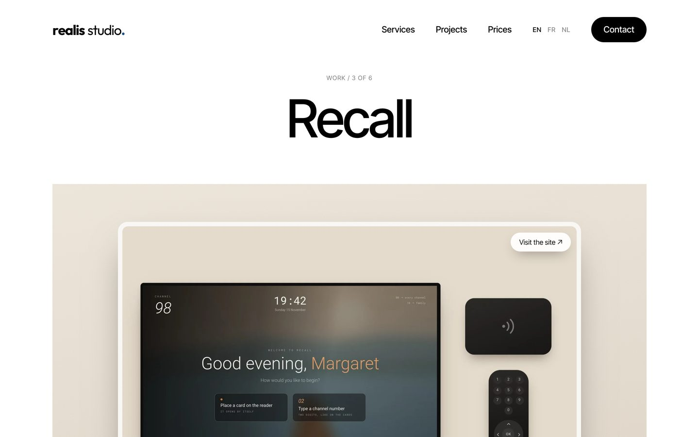
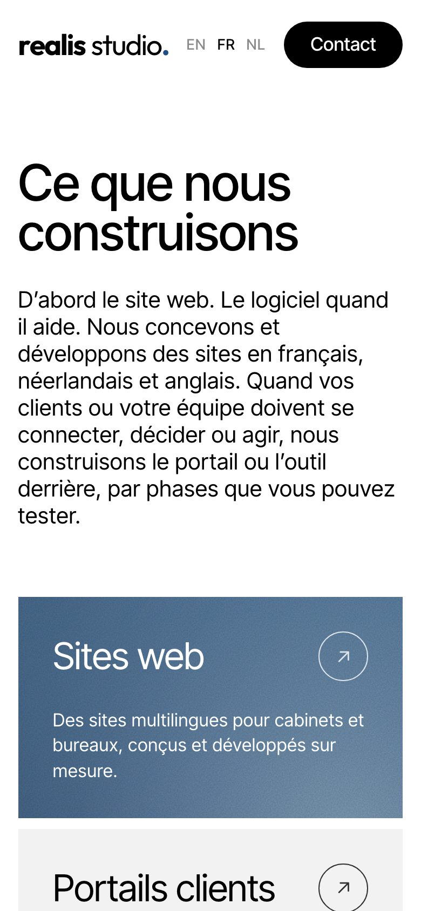

# Realis Studio — website

The website of [Realis Studio](https://realisstudio.com), a small web and software studio, in English, French and Dutch.
Static pages served from Cloudflare's edge, with one small Worker for the contact form, redirects and the canonical address.

> A clean snapshot of a private repository, shared for review.

| A project page (sample data) | On a phone, in French |
|---|---|
|  |  |

## Why it is built this way

- **Plain pages, fast everywhere.** Every page is static HTML at its own address in three languages. There is no framework at runtime and nothing to hydrate. Structured data, hreflang and a sitemap with real change dates tell search engines what each page is.
- **Motion that respects the reader.** The animations are built from the measured text, only once the web fonts are in, so nothing jumps. The fonts never hold the first paint. Visitors who ask for less motion get stills instead.
- **One small Worker, tested.**
  - The contact form posts to the same origin, checks Cloudflare Turnstile and a honeypot, and sends the enquiry itself, with no third-party form service.
  - Old addresses move with one 301, never a chain.
- **Every release is checked.** The tests run over the built site: three languages per page, every link resolving, the structured data, the contact form wiring, and privacy rules such as no client named where it must not be. After a deploy, a smoke test calls 106 live addresses.

## Stack

- HTML, CSS and vanilla JavaScript; [GSAP](https://gsap.com) and [Lenis](https://github.com/darkroomengineering/lenis) for motion.
- Cloudflare Workers: static assets plus `worker/` in TypeScript, configured in `wrangler.jsonc`.
- `node:test` for the tests. The browser checks (Playwright, Chromium and WebKit, reduced motion included) are not part of this snapshot.
- The pages in `site/` are generated by the studio's own build pipeline (Python), which is not part of this snapshot either.

## What is here

| Path | What it is |
|---|---|
| `site/` | The built site, as it is served: 54 pages in three languages, styles, scripts, images |
| `worker/` | The Worker: canonical host, redirects, the contact form (`contact.ts`, `mime.ts`) |
| `tests/` | The tests: the built site, the Worker, the redirects, the contact form |
| `scripts/` | `release.sh` (test, deploy, notify search engines, smoke test), `smoke-live.mjs`, `indexnow.mjs` |
| `src/` | The site settings and the three dictionaries the tests read |

The email address and the two phone numbers in the site are the studio’s published contact details, shown on every page of realisstudio.com.

## Run it

Needs Node 22.18 or later (the tests run TypeScript directly).

```bash
npm test          # copies site/ to dist/, then runs the tests
```

To serve it with the Worker, you need your own Cloudflare account. Replace every `REPLACE_ME` first:

- `wrangler.jsonc`: the two routes, `CONTACT_FROM`, `CONTACT_TO` and the `send_email` destination;
- `src/config.ts`: `googleSiteVerification`;
- the Turnstile secret: `npx wrangler secret put TURNSTILE_SECRET`.

Then:

```bash
npm install
npx wrangler dev
```

## Credits

Designed and built by Realis Studio. Lead software engineer: Andy Huizenga.

## License

All rights reserved — shared for review only. The websites shown in the projects belong to the clients concerned.
